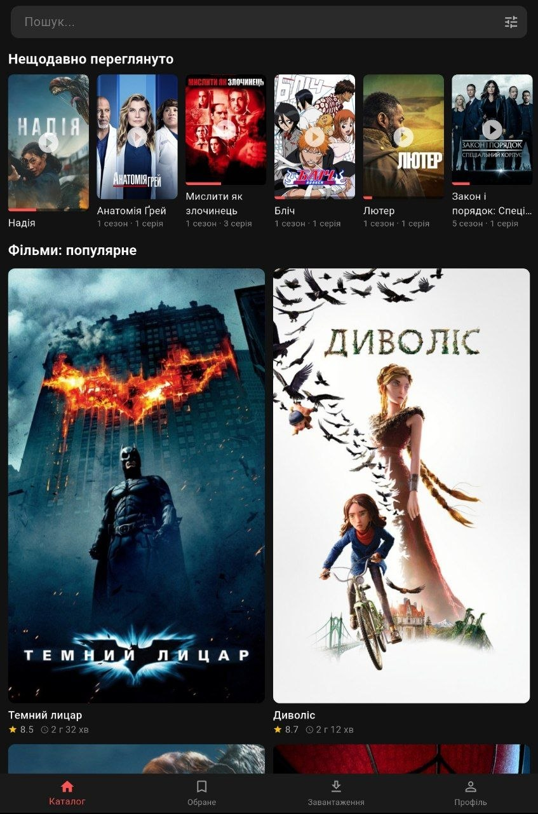
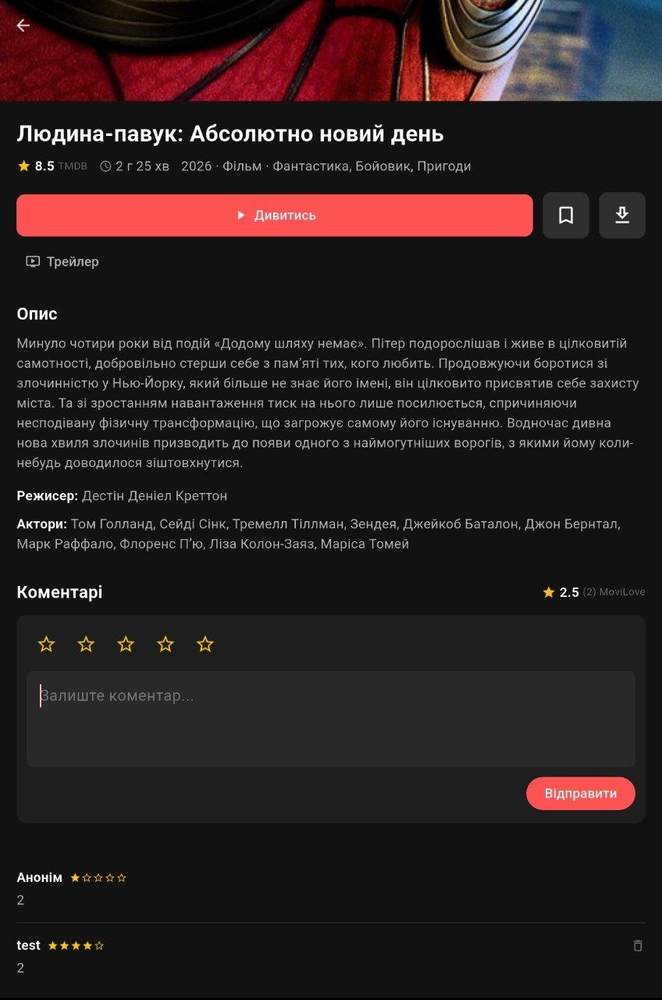
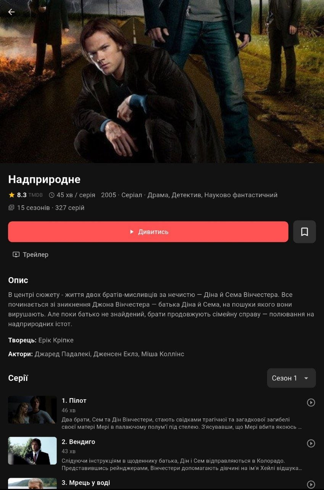
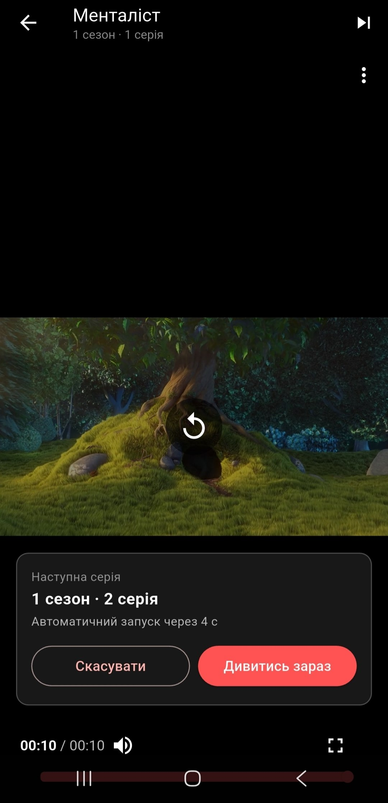

# MoviLove

**MoviLove** — мобільний застосунок-стрімінг на Flutter для перегляду фільмів, серіалів та аніме. Навчальний демо-проєкт: каталог і метадані беруться з [TMDB](https://www.themoviedb.org/), акаунти й дані користувачів зберігаються у Firebase.

> **Це демо.** Справжнього відеоконтенту в застосунку немає: усі фільми й серії відтворюють один і той самий 10-секундний тестовий ролик. Оплата підписки — імітація, дані картки ніде не зберігаються.

## Скріншоти

| Каталог | Фільм | Серіал | Плеєр |
|---|---|---|---|
|  |  |  |  |


## Можливості

- **Вхід і реєстрація** (email + пароль), онбординг, режим гостя («Пропустити»)
- **Каталог** з популярним контентом TMDB, сітка карток із рейтингом і тривалістю
- **Пошук** у реальному часі (фільми й серіали)
- **Фільтри:** тип (Фільми / Серіали / Аніме) і жанри
- **Пагінація:** кнопка «Переглянути ще +20»
- **Екран фільму/серіалу:** опис, жанри, режисер/творець, актори, кнопка «Трейлер» (відкриває YouTube)
- **Сезони й серії** для серіалів та аніме: вибір сезону, список серій із кадрами, тривалістю та описом
- **Плеєр** з продовженням перегляду з того місця, де зупинився; для серіалів — кнопка «Наступна серія» й автоперехід із відліком
- **Нещодавно переглянуте:** прогрес перегляду на постері, запуск саме тієї серії, де зупинився
- **Обране** (синхронізується через Firestore)
- **Коментарі й оцінки (1–5)** зі середньою оцінкою користувачів MoviLove
- **Підписка** (імітація оплати): перегляд і завантаження доступні лише з підпискою
- **Офлайн-завантаження** фільмів і вкладка «Завантаження», що працює без інтернету
- **Профіль:** нікнейм, країна, вихід

## Технології

- Flutter / Dart, Material 3, темна тема
- Firebase: Authentication, Cloud Firestore
- TMDB API (запити з `language=uk-UA`)
- Пакети: `firebase_core`, `firebase_auth`, `cloud_firestore`, `http`, `video_player`, `chewie`, `path_provider`, `url_launcher`

## Структура `lib/`

```
lib/
├── main.dart
├── models/      — Movie, MediaDetails, Episode/SeasonInfo, Comment, жанри
├── services/    — tmdb_service, watch_access (підписка), download_service
├── screens/     — каталог, екран фільму, плеєр, профіль, обране, підписка, вхід...
└── widgets/     — коментарі, серії, «Нещодавно переглянуте», фільтри, кнопка завантаження
```

## Як запустити

### 1. Вимоги
- Flutter SDK (з Dart 3), Android Studio або VS Code
- Акаунт TMDB та проєкт Firebase (безкоштовно)

### 2. Клонуй репозиторій і встанови пакети
```bash
git clone https://github.com/GitLab58000/MoviLove.git
cd MoviLove
flutter pub get
```

### 3. Ключ TMDB
1. Отримай ключ API: https://www.themoviedb.org/settings/api
2. Скопіюй `lib/secrets.example.dart` у `lib/secrets.dart`
3. Встав свій ключ у `lib/secrets.dart`:
   ```dart
   class Secrets {
     static const String tmdbApiKey = 'ТВІЙ_КЛЮЧ';
   }
   ```

### 4. Firebase
1. Створи проєкт у [Firebase Console](https://console.firebase.google.com/).
2. Увімкни **Authentication → Email/Password** і створи базу **Cloud Firestore**.
3. Додай Android-застосунок і згенеруй конфігурацію:
   ```bash
   dart pub global activate flutterfire_cli
   flutterfire configure
   ```
   Команда створить `lib/firebase_options.dart` (а також потрібні файли для Android). Шаблон дивись у `lib/firebase_options.example.dart`.
4. У Firestore → **Rules** встав вміст файлу [`firestore.rules`](firestore.rules) і опублікуй.

### 5. Запуск
```bash
flutter run
```

> Файли `lib/secrets.dart`, `lib/firebase_options.dart` та `google-services.json` навмисно **не** лежать у репозиторії (вони в `.gitignore`), тому без кроків 3–4 застосунок не запуститься.

## Обмеження

- Усе відтворює один демо-ролик (~10 с); для серіалів завантаження не передбачені.
- Завантаження зберігаються локально й спільні для всіх акаунтів на пристрої.
- Без інтернету каталог не працює (дані з TMDB), працює лише вкладка «Завантаження».
- Імена акторів і режисерів TMDB віддає як записано (часто латиницею); опис українською є не в усіх фільмів.
- «Аніме» визначається евристикою (жанр «Мультфільм» + японська оригінальна мова).
- Пошук не враховує фільтри (обмеження TMDB), застосування фільтра очищає поле пошуку.
